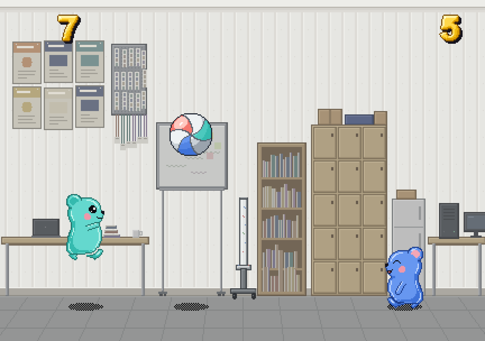

# ANA Volleyball

_&check;_ _English_ | [_Korean(한국어)_](README.ko.md)

ANA Volleyball is a remake of Pikachu Volleyball with the characters and the club room of the ANA club at Chungnam National University. Three jelly characters (the turquoise A, the blue N and the coral A) play in the club room, over the club's whiteboard on wheels. Each player picks a character before the game.

The rules, the physics and the controls are unchanged: the game runs on the reverse engineered web version of the original Pikachu Volleyball by [Kyutae Lee (gorisanson)](https://github.com/gorisanson/pikachu-volleyball).



## Credits

- Original game, Pikachu Volleyball (対戦ぴかちゅ～　ﾋﾞｰﾁﾊﾞﾚｰ編): (C) 1997 SACHI SOFT / SAWAYAKAN Programmers, (C) 1997 Satoshi Takenouchi
- Reverse engineered web version: [gorisanson/pikachu-volleyball](https://github.com/gorisanson/pikachu-volleyball) by Kyutae Lee
- ANA remake (characters, club room, character select): this repository

## What this remake changes

- Characters, background, title, menu, ball and score textures are generated by Python (Pillow) scripts in [`tools/pixelart/`](tools/pixelart/) and packed into the sprite sheet by [`tools/pack_sprite_sheet.py`](tools/pack_sprite_sheet.py).
- A character select screen follows the menu ([`src/resources/js/pikavolley.js`](src/resources/js/pikavolley.js), [`src/resources/js/view.js`](src/resources/js/view.js)).
- [`src/resources/js/physics.js`](src/resources/js/physics.js) is untouched.
- The sound effects are still the original ones for now.

## How to run locally

1. Clone this repository and get into the directory.

```sh
git clone https://github.com/Hraverals/ana-volleyball.git
cd ana-volleyball
```

2. Install dependencies. (If errors occur, you can try with `node v16` and `npm v8`.)

```sh
npm install
```

3. Bundle the code.

```sh
npm run build
```

4. Run a local web server.

```sh
npx http-server dist
```

5. Connect to the local web server on a web browser. (In most cases, the URL for connecting to the server would be `http://localhost:8080`. For the exact URL, it is supposed to be found on the printed messages on your terminal.)

## Game structure (from the original web version)

- Physics Engine: The physics engine, which calculates the position of the ball and the players, is contained in the file [`src/resources/js/physics.js`](src/resources/js/physics.js). (This file also containes the AI which determines the keyboard input of the computer when you are playing against your computer.) This source code file is gained by reverse engineering the function at the address 00403dd0 of the machine code of the original game.

- Rendering: [PixiJS](https://github.com/pixijs/pixi.js) library is used for rendering the game.

Refer comments on [`src/resources/js/main.js`](src/resources/js/main.js) for other details.

## Methods used for reverse engineering (original web version)

The main tools used for reverse engineering are following.

- [Ghidra](https://ghidra-sre.org/)
- [Cheat Engine](https://www.cheatengine.org/)
- [OllyDbg](http://www.ollydbg.de/)
- [Resource Hacker](http://www.angusj.com/resourcehacker/)

[Ghidra](https://ghidra-sre.org/) is used for decompiling the machine code to C code. At first look, the decompiled C code looked incomprehensible. One of the reason was that the variable names (`iVar1`, `iVar2`, ...) and function names (`FUN_00402dc0`, `FUN_00403070`, ...) in the decompiled C code are meaningless. But, with the aid of [Cheat Engine](https://www.cheatengine.org/), I could find the location of some significant variables &mdash; x, y coordinate of the ball and the players. And reading from the location of the variables, the decompiled C code was comprehensible! [OllyDbg](http://www.ollydbg.de/) was used for altering a specific part of the machine code. For example, to make slower version of the game so that it would be easier to count the number of frames of "Ready?" message on the start of new round in the game. [Resource Hacker](http://www.angusj.com/resourcehacker/) was used for extract the assets (sprites and sounds) of the game.

## An intended deviation from the original game (original web version)

If there is no keyboard input, AI vs AI match is started after a while. In the original game, the match lasts only for about 40 seconds. But in this JavaScript version, there's no time limit to the AI vs AI match so you can watch it as long as you want.
